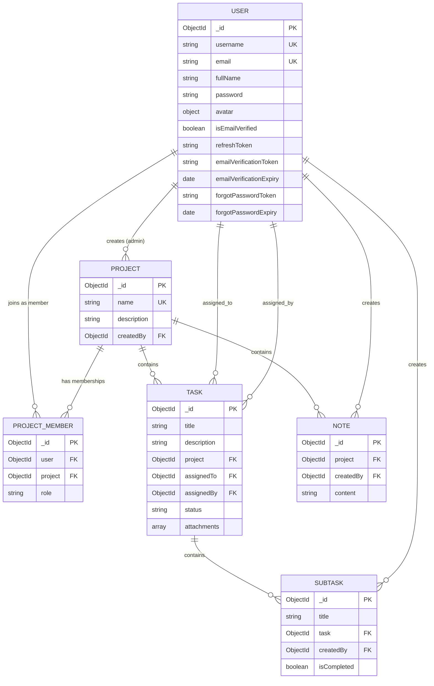

# Project Camp Backend API

A RESTful backend API service engineered for collaborative project management. Built with Node.js, Express 5, and MongoDB with Mongoose, the system provides project workflows, hierarchical task and subtask tracking, project notes, multi-file attachments, and role-based access control (RBAC) backed by JWT authentication and automated email workflows.

---

## Table of Contents

- [Overview](#overview)
- [Architecture & Tech Stack](#architecture--tech-stack)
- [Project Directory Structure](#project-directory-structure)
- [Data Models & Schema Relationships](#data-models--schema-relationships)
- [Role-Based Access Control (RBAC)](#role-based-access-control-rbac)
- [Environment Variables](#environment-variables)
- [Getting Started](#getting-started)
- [Troubleshooting DNS Resolution](#troubleshooting-dns-resolution)
- [API Reference](#api-reference)
  - [System Health](#system-health)
  - [Authentication & Account](#authentication--account)
  - [Projects & Team Members](#projects--team-members)
  - [Tasks & Subtasks](#tasks--subtasks)
  - [Project Notes](#project-notes)
- [Standard API Response Formats](#standard-api-response-formats)
- [File Upload Handling](#file-upload-handling)

---

## Overview

Project Camp Backend delivers the server-side infrastructure for project management tools:
- **Authentication & Security:** User registration with avatar upload, email verification tokens via Mailtrap, JWT authentication (access and refresh tokens via httpOnly cookies or Authorization headers), and password reset flows.
- **Projects:** Creation, updates, deletions, and aggregation-driven member listings with computed member counts.
- **Team Collaboration:** Project member invitations by email with granular roles (`admin`, `project_admin`, `member`).
- **Tasks & Subtasks:** Task scheduling with assignees, status tracking (`todo`, `in_progress`, `done`), multi-file attachments via Multer, and nested subtasks with role-aware completion toggles.
- **Project Notes:** Internal team documentation and notes tied directly to projects.

---

## Architecture & Tech Stack

| Layer / Concern | Technology | Version | Purpose |
| :--- | :--- | :--- | :--- |
| **Runtime** | [Node.js](https://nodejs.org/) | >= 18.0.0 (ES Modules) | Server execution environment |
| **Web Framework** | [Express](https://expressjs.com/) | 5.2.1 | HTTP request pipeline, routing, and middleware |
| **Database** | [MongoDB](https://www.mongodb.com/) | >= 7.0 | Primary document database |
| **ODM** | [Mongoose](https://mongoosejs.com/) | 9.7.1 | Data modeling, validations, and aggregation pipelines |
| **Authentication** | [jsonwebtoken](https://github.com/auth0/node-jsonwebtoken) | 9.0.3 | Signed JWT access and refresh token generation |
| **Password Hashing** | [bcrypt](https://github.com/kelektiv/node.bcrypt.js) | 6.0.0 | Salted password hashing in pre-save hooks |
| **File Uploads** | [Multer](https://github.com/expressjs/multer) | 2.4.0 | Multipart form-data disk storage for avatars and task files |
| **Email Delivery** | [Nodemailer](https://nodemailer.com/) & [Mailgen](https://github.com/eladnava/mailgen) | 9.0.1 / 2.0.34 | Transactional email delivery and responsive HTML email templates |
| **Validation** | [express-validator](https://express-validator.github.io/) | 7.3.2 | Route-level request body and param sanitization and validation |
| **Cookie Parsing** | [cookie-parser](https://github.com/expressjs/cookie-parser) | 1.4.7 | Cookie extraction for JWT token verification |
| **Development** | [nodemon](https://nodemon.io/) | 3.1.14 | Automatic server restarts upon file changes |

---

## Project Directory Structure

```text
backend/
├── .env.example              # Template for environment configuration
├── .prettierrc               # Code formatting preferences
├── Note.txt                  # DNS SRV resolution troubleshooting guide
├── package.json              # Dependencies and runtime scripts
├── public/
│   └── images/               # Upload destination for avatars and task attachments
└── src/
    ├── app.js                # Express app initialization, CORS, global middleware, routes
    ├── index.js              # Server entry point, DNS configuration, and database connection
    ├── controllers/
    │   ├── auth.contollers.js        # Registration, login, logout, password & verification flows
    │   ├── healthcheck.controllers.js # Health check endpoint controller
    │   ├── note.controllers.js       # Project note CRUD operations
    │   ├── project.controllers.js    # Project management and membership controllers
    │   └── task.contollers.js        # Task, subtask, and attachment controllers
    ├── db/
    │   └── index.js          # MongoDB connection handler via Mongoose
    ├── middlewares/
    │   ├── auth.middleware.js        # JWT verification and project role permission checks
    │   ├── multer.middleware.js      # Multer disk storage and file limit config (1MB)
    │   └── validator.middleware.js   # express-validator result handler
    ├── models/
    │   ├── note.models.js            # Note schema definition
    │   ├── project.models.js         # Project schema definition
    │   ├── projectmember.models.js   # ProjectMember schema and role bindings
    │   ├── subtask.model.js          # Subtask schema definition
    │   ├── task.models.js            # Task schema with attachments array
    │   └── user.models.js            # User schema with auth methods and bcrypt hooks
    ├── routes/
    │   ├── auth.routes.js            # /api/v1/auth route declarations
    │   ├── healthcheck.routes.js     # /api/v1/healthcheck route declarations
    │   ├── note.routes.js            # /api/v1/notes route declarations
    │   ├── project.routes.js         # /api/v1/projects route declarations
    │   └── task.routes.js            # /api/v1/tasks route declarations
    ├── utils/
    │   ├── api-error.js              # Standardized ApiError class
    │   ├── api-response.js           # Standardized ApiResponse envelope
    │   ├── async-handler.js          # Async wrapper utility for controllers
    │   ├── constants.js              # User roles and task status constants
    │   └── mail.js                   # Nodemailer transporter and Mailgen templates
    └── validators/
        └── index.js                  # Request validation schemas
```

---

## Data Models & Schema Relationships

The data model maintains clear relational separation between users, projects, memberships, tasks, subtasks, and notes.



### Enumerations

- **User Roles (`AvailableUserRole`):**
  - `admin` - Project creator with full administrative authority over the project, members, tasks, and notes.
  - `project_admin` - Project manager with privileges to manage tasks, subtasks, and view notes.
  - `member` - Standard team collaborator with permissions to view project data, update task statuses, and toggle subtask completion.
- **Task Statuses (`AvailableTaskStatus`):**
  - `todo` - Initial status upon task creation.
  - `in_progress` - Task is actively being worked on.
  - `done` - Task has been completed.

---

## Role-Based Access Control (RBAC)

Project-level routes enforce role verification through the `validateProjectPermission` middleware:

| Feature / Action | Admin | Project Admin | Member | Notes |
| :--- | :---: | :---: | :---: | :--- |
| **Create Project** | Yes | No | No | Creator automatically becomes `admin` in `ProjectMember` |
| **Update / Delete Project** | Yes | No | No | Admin only |
| **View Project Details & Members** | Yes | Yes | Yes | Requires active membership in the project |
| **Add / Remove Project Members** | Yes | No | No | Admin manages project membership |
| **Update Member Role** | Yes | No | No | Admin changes role to `admin`, `project_admin`, or `member` |
| **Create / Update / Delete Tasks** | Yes | Yes | No | Admin and Project Admin only |
| **View Project Tasks & Details** | Yes | Yes | Yes | All project members |
| **Create Subtasks** | Yes | Yes | No | Admin and Project Admin only |
| **Update Subtask Status (`isCompleted`)** | Yes | Yes | Yes | Members can toggle completion |
| **Update Subtask Title** | Yes | Yes | No | Members cannot edit subtask title |
| **Delete Subtask** | Yes | Yes | No | Admin and Project Admin only |
| **Create / Update / Delete Notes** | Yes | No | No | Admin only |
| **View Project Notes** | Yes | Yes | Yes | All project members |

---

## Environment Variables

Copy the provided example environment file to configure your local or deployment runtime:

```bash
cp backend/.env.example backend/.env
```

| Variable | Description | Example / Default |
| :--- | :--- | :--- |
| `PORT` | Port number for the Express HTTP server | `8000` |
| `NODE_ENV` | Environment mode (`development` or `production`) | `development` |
| `SERVER_URL` | Base URL of the backend server (used for attachment and avatar URL construction) | `http://localhost:8000` |
| `CORS_ORIGIN` | Allowed client origin for CORS headers | `http://localhost:5173` |
| `MONGO_URI` | MongoDB connection string (Atlas or local instance) | `mongodb+srv://<user>:<password>@cluster.mongodb.net/projmanage` |
| `ACCESS_TOKEN_SECRET` | Secret key for signing short-lived JWT access tokens | `replace-with-a-long-random-access-secret` |
| `ACCESS_TOKEN_EXPIRY` | Lifetime of the access token | `1d` |
| `REFRESH_TOKEN_SECRET` | Secret key for signing long-lived JWT refresh tokens | `replace-with-a-long-random-refresh-secret` |
| `REFRESH_TOKEN_EXPIRY` | Lifetime of the refresh token | `10d` |
| `FORGOT_PASSWORD_REDIRECT_URL` | Client frontend route used in password reset email links | `http://localhost:5173/reset-password` |
| `MAILTRAP_SMTP_HOST` | SMTP server host for sending verification and reset emails | `sandbox.smtp.mailtrap.io` |
| `MAILTRAP_SMTP_PORT` | SMTP port | `2525` |
| `MAILTRAP_SMTP_USER` | Mailtrap inbox username | `replace-with-mailtrap-username` |
| `MAILTRAP_SMTP_PASS` | Mailtrap inbox password | `replace-with-mailtrap-password` |

---

## Getting Started

### Prerequisites

- [Node.js](https://nodejs.org/) version 18.0.0 or higher
- [npm](https://www.npmjs.com/) (bundled with Node.js)
- A running [MongoDB](https://www.mongodb.com/) instance or MongoDB Atlas cluster URI
- A [Mailtrap](https://mailtrap.io/) account for capturing transactional emails during development

### 1. Installation

Navigate to the `backend` folder and install project dependencies:

```bash
cd backend
npm install
```

### 2. Configure Environment

Create and edit the `.env` file with your credentials:

```bash
cp .env.example .env
```

Ensure your `MONGO_URI`, JWT secrets, and Mailtrap credentials are set.

### 3. Run the Development Server

Start the application with `nodemon` for hot-reload on code modifications:

```bash
npm run dev
```

The server will start listening at:
```text
http://localhost:8000
```

To run without `nodemon` (production start):

```bash
npm start
```

---

## Troubleshooting DNS Resolution

When connecting to MongoDB Atlas (`mongodb+srv://...`), some local network DNS configurations (such as local loopback `127.0.0.1` resolvers) can fail to resolve SRV records, yielding:

```text
Error: querySrv ECONNREFUSED _mongodb._tcp.cluster0.xxxxxx.mongodb.net
```

The application explicitly handles this in `src/index.js` by configuring public DNS resolvers before connecting:

```javascript
import dns from "node:dns";
dns.setServers(["1.1.1.1", "8.8.8.8"]);
```

If you encounter SRV connection errors in alternate scripts, apply this configuration prior to initiating the database connection.

---

## API Reference

Base URL prefix for all API routes: `/api/v1`

### System Health

#### Check System Status
- **Method:** `GET`
- **Route:** `/api/v1/healthcheck`
- **Authentication:** None (Public)
- **Success Response (200 OK):**
```json
{
  "statusCode": 200,
  "data": "OK",
  "message": "Health check successful",
  "success": true
}
```

---

### Authentication & Account

Base route: `/api/v1/auth`

#### 1. Register User
- **Method:** `POST`
- **Route:** `/api/v1/auth/register`
- **Authentication:** Public
- **Content-Type:** `multipart/form-data`
- **Fields:**
  - `email` (string, required, valid email format)
  - `username` (string, required, lowercase, 3-20 characters)
  - `fullName` (string, required, 3-100 characters)
  - `password` (string, required, 8-100 characters)
  - `avatar` (file, optional, single image <= 1MB)
- **Response (201 Created):**
```json
{
  "statusCode": 201,
  "data": {
    "user": {
      "_id": "660c2834b7f9411d9990e111",
      "username": "rohitsingh",
      "email": "rohit@example.com",
      "fullName": "Rohit Singh",
      "isEmailVerified": false,
      "avatar": {
        "url": "http://localhost:8000/images/1712000000000-avatar.png",
        "localPath": "public/images/1712000000000-avatar.png"
      },
      "createdAt": "2026-10-25T10:00:00.000Z",
      "updatedAt": "2026-10-25T10:00:00.000Z"
    }
  },
  "message": "User registered successfully and verification email has been sent on your email.",
  "success": true
}
```

#### 2. Login User
- **Method:** `POST`
- **Route:** `/api/v1/auth/login`
- **Authentication:** Public
- **Request Body (JSON):**
```json
{
  "email": "rohit@example.com",
  "password": "Password123"
}
```
*(You may supply either `email` or `username` along with `password`)*
- **Response (200 OK):** Sets `accessToken` and `refreshToken` in httpOnly cookies and returns token payloads.

#### 3. Logout User
- **Method:** `POST`
- **Route:** `/api/v1/auth/logout`
- **Authentication:** Required (`verifyJWT`)
- **Response (200 OK):** Clears authentication cookies and invalidates refresh token in the database.

#### 4. Get Current User
- **Method:** `GET`
- **Route:** `/api/v1/auth/current-user`
- **Authentication:** Required (`verifyJWT`)
- **Response (200 OK):** Returns authenticated user profile without sensitive fields.

#### 5. Verify Email
- **Method:** `GET`
- **Route:** `/api/v1/auth/verify-email/:verificationToken`
- **Authentication:** Public
- **Response (200 OK):** Marks account `isEmailVerified: true`.

#### 6. Resend Email Verification
- **Method:** `POST`
- **Route:** `/api/v1/auth/resend-verification-email`
- **Authentication:** Required (`verifyJWT`)
- **Response (200 OK):** Generates a fresh verification token and dispatches email.

#### 7. Refresh Access Token
- **Method:** `POST`
- **Route:** `/api/v1/auth/refresh-token`
- **Authentication:** Public (Accepts `refreshToken` via cookie or JSON body `{ "refreshToken": "..." }`)
- **Response (200 OK):** Returns new `accessToken` and `refreshToken` pair.

#### 8. Forgot Password Request
- **Method:** `POST`
- **Route:** `/api/v1/auth/forgot-password`
- **Authentication:** Public
- **Request Body (JSON):**
```json
{
  "email": "rohit@example.com"
}
```
- **Response (200 OK):** Sends password reset link containing temporary token to user email.

#### 9. Reset Password
- **Method:** `POST`
- **Route:** `/api/v1/auth/reset-password/:resetToken`
- **Authentication:** Public
- **Request Body (JSON):**
```json
{
  "newPassword": "NewSecurePassword123"
}
```
- **Response (200 OK):** Updates user password and clears temporary reset token.

#### 10. Change Password
- **Method:** `POST`
- **Route:** `/api/v1/auth/change-password`
- **Authentication:** Required (`verifyJWT`)
- **Request Body (JSON):**
```json
{
  "oldPassword": "CurrentPassword123",
  "newPassword": "NewSecurePassword123"
}
```
- **Response (200 OK):** Validates existing password and applies new hashed password.

---

### Projects & Team Members

Base route: `/api/v1/projects` (All endpoints require `verifyJWT`)

#### 1. List User Projects
- **Method:** `GET`
- **Route:** `/api/v1/projects`
- **Access:** Authenticated user
- **Description:** Returns all projects the current user belongs to, including project metadata, the user's role in the project, and total member count.

#### 2. Create Project
- **Method:** `POST`
- **Route:** `/api/v1/projects`
- **Access:** Authenticated user
- **Request Body (JSON):**
```json
{
  "name": "Mobile Redesign",
  "description": "Redesign mobile application experience"
}
```
- **Description:** Creates the project document and adds the calling user as `admin` in `ProjectMember`.

#### 3. Get Project Details
- **Method:** `GET`
- **Route:** `/api/v1/projects/:projectId`
- **Access:** Project Members (`admin`, `project_admin`, `member`)

#### 4. Update Project
- **Method:** `PUT`
- **Route:** `/api/v1/projects/:projectId`
- **Access:** Project `admin` only
- **Request Body (JSON):**
```json
{
  "name": "Mobile Redesign V2",
  "description": "Updated project description"
}
```

#### 5. Delete Project
- **Method:** `DELETE`
- **Route:** `/api/v1/projects/:projectId`
- **Access:** Project `admin` only

#### 6. List Project Members
- **Method:** `GET`
- **Route:** `/api/v1/projects/:projectId/members`
- **Access:** Project Members (`admin`, `project_admin`, `member`)
- **Description:** Returns member details (`username`, `email`, `fullName`, `avatar`, and `role`).

#### 7. Add Member to Project
- **Method:** `POST`
- **Route:** `/api/v1/projects/:projectId/members`
- **Access:** Project `admin` only
- **Request Body (JSON):**
```json
{
  "email": "teammate@example.com",
  "role": "member"
}
```
*(Role must be one of: `admin`, `project_admin`, `member`)*

#### 8. Update Member Role
- **Method:** `PUT`
- **Route:** `/api/v1/projects/:projectId/members/:userId`
- **Access:** Project `admin` only
- **Request Body (JSON):**
```json
{
  "newRole": "project_admin"
}
```

#### 9. Remove Member from Project
- **Method:** `DELETE`
- **Route:** `/api/v1/projects/:projectId/members/:userId`
- **Access:** Project `admin` only

---

### Tasks & Subtasks

Base route: `/api/v1/tasks` (All endpoints require `verifyJWT`)

#### 1. List Tasks for Project
- **Method:** `GET`
- **Route:** `/api/v1/tasks/:projectId`
- **Access:** Project Members (`admin`, `project_admin`, `member`)
- **Description:** Returns tasks for the project populated with assignee details.

#### 2. Create Task
- **Method:** `POST`
- **Route:** `/api/v1/tasks/:projectId`
- **Access:** Project `admin` or `project_admin`
- **Content-Type:** `multipart/form-data`
- **Fields:**
  - `title` (string, required, 3-100 characters)
  - `description` (string, optional, max 500 characters)
  - `assignedTo` (MongoDB ObjectId, optional)
  - `status` (string, optional: `todo` | `in_progress` | `done`, default `todo`)
  - `attachments` (files, optional, array of files <= 1MB each)

#### 3. Get Task by ID
- **Method:** `GET`
- **Route:** `/api/v1/tasks/:projectId/t/:taskId`
- **Access:** Project Members (`admin`, `project_admin`, `member`)
- **Description:** Returns task details with populated assignee, subtasks list, and creator information.

#### 4. Update Task
- **Method:** `PUT`
- **Route:** `/api/v1/tasks/:projectId/t/:taskId`
- **Access:** Project `admin` or `project_admin`
- **Request Body (JSON):**
```json
{
  "title": "Design Homepage Mockups",
  "description": "Complete initial Figma designs",
  "assignedTo": "660c2834b7f9411d9990e111",
  "status": "in_progress"
}
```

#### 5. Delete Task
- **Method:** `DELETE`
- **Route:** `/api/v1/tasks/:projectId/t/:taskId`
- **Access:** Project `admin` or `project_admin`

#### 6. Create Subtask
- **Method:** `POST`
- **Route:** `/api/v1/tasks/:projectId/t/:taskId/subtasks`
- **Access:** Project `admin` or `project_admin`
- **Request Body (JSON):**
```json
{
  "title": "Prepare typography guidelines"
}
```

#### 7. Update Subtask
- **Method:** `PUT`
- **Route:** `/api/v1/tasks/:projectId/st/:subTaskId`
- **Access:** Project Members (`admin`, `project_admin`, `member`)
- **Behavior:**
  - Team members (`member`) are permitted to update only the `isCompleted` boolean field:
    ```json
    {
      "isCompleted": true
    }
    ```
  - Admins and Project Admins may update both `title` and `isCompleted`:
    ```json
    {
      "title": "Updated subtask title",
      "isCompleted": true
    }
    ```

#### 8. Delete Subtask
- **Method:** `DELETE`
- **Route:** `/api/v1/tasks/:projectId/st/:subTaskId`
- **Access:** Project `admin` or `project_admin`

---

### Project Notes

Base route: `/api/v1/notes` (All endpoints require `verifyJWT`)

#### 1. List Project Notes
- **Method:** `GET`
- **Route:** `/api/v1/notes/:projectId`
- **Access:** Project Members (`admin`, `project_admin`, `member`)
- **Description:** Returns notes with author profile info (`username`, `fullName`, `email`).

#### 2. Create Note
- **Method:** `POST`
- **Route:** `/api/v1/notes/:projectId`
- **Access:** Project `admin` only
- **Request Body (JSON):**
```json
{
  "content": "Sprint kickoff scheduled for Monday at 10:00 AM UTC."
}
```

#### 3. Get Note by ID
- **Method:** `GET`
- **Route:** `/api/v1/notes/:projectId/n/:noteId`
- **Access:** Project Members (`admin`, `project_admin`, `member`)

#### 4. Update Note
- **Method:** `PUT`
- **Route:** `/api/v1/notes/:projectId/n/:noteId`
- **Access:** Project `admin` only
- **Request Body (JSON):**
```json
{
  "content": "Updated sprint notes and action items."
}
```

#### 5. Delete Note
- **Method:** `DELETE`
- **Route:** `/api/v1/notes/:projectId/n/:noteId`
- **Access:** Project `admin` only

---

## Standard API Response Formats

All API responses adhere to unified envelope conventions.

### Success Response Envelope

```json
{
  "statusCode": 200,
  "data": { ... },
  "message": "Operation completed successfully",
  "success": true
}
```

### Error Response Envelope

```json
{
  "success": false,
  "message": "Error description message",
  "errors": [
    {
      "type": "field",
      "value": "invalid",
      "msg": "Invalid email address",
      "path": "email",
      "location": "body"
    }
  ]
}
```

Common status codes returned:
- `200 OK` - Request completed successfully.
- `201 Created` - Resource created successfully.
- `400 Bad Request` - Validation failure or missing required parameters.
- `401 Unauthorized` - Missing or expired authentication token.
- `403 Forbidden` - User role lacks sufficient permissions for the requested action.
- `404 Not Found` - Target resource or document does not exist.
- `409 Conflict` - Resource duplicate conflict (e.g., username or email already registered).
- `500 Internal Server Error` - Unhandled server exception.

---

## File Upload Handling

- **Middleware:** Configured in `src/middlewares/multer.middleware.js`.
- **Storage Target:** Uploaded files are written directly to `public/images/`.
- **Static Exposure:** Express serves assets statically at `/images/<filename>`.
- **File Constraints:** Enforced file size limit of 1,000,000 bytes (1MB) per file.
- **Access URLs:** Formatted using `SERVER_URL` as defined in `.env` (for instance, `http://localhost:8000/images/1712000000000-filename.png`).

---
